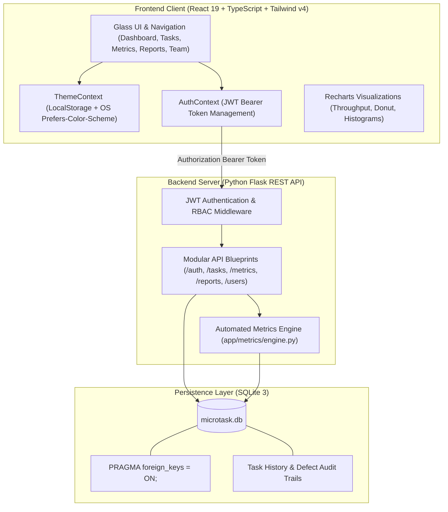
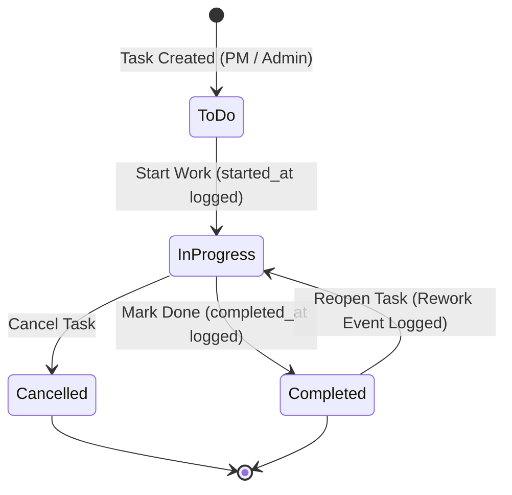

# Micro-Task Management System with Automated Software Metrics Dashboard

<div align="center">


-003B57?style=for-the-badge&logo=sqlite&logoColor=white)


<p align="center">
  <strong>An enterprise-grade, academic-ready full-stack software engineering project with live process metrics calculation, role-based workflows, automated defect tracking, and persistent light/dark themes.</strong>
</p>

[Quick Start](#-quick-start-guide) • [Architecture](#-system-architecture) • [Engineering Metrics](#-automated-metrics-engine) • [API Specification](#-rest-api-overview) • [Demo Credentials](#-demonstration-credentials) • [Documentation](#-documentation-index)

</div>

---

## Highlights & Capabilities

- **Automated Process Metrics Engine**: Live computation of Completion Rate, Cycle Time, Throughput, Defect Rate, and Rework Rate straight from relational audit logs.
- **Dynamic Dual-Theme System**: Polished Light and Dark modes with instant toggling, OS preference detection, zero flash of unstyled content (FOUC), and Recharts color adaptation.
- **Strict Role-Based Access Control (RBAC)**: Enforced across Administrator, Project Manager, and Team Member roles on both frontend and backend API endpoints.
- **Granular Task Lifecycle State Machine**: Full tracking of `todo`, `in_progress`, and `completed` states with automated rework auditing whenever completed deliverables are reopened.
- **Defect & Quality Telemetry**: Integrated bug reporting tied to parent deliverables, feeding into overall software quality indices.
- **Reporting & CSV Export**: Dynamic date-range and user filtering with RFC-4180 compliant CSV export for external audit.
- **100% Automated Test Coverage**: Comprehensive Pytest suite validating authentication, RBAC boundaries, soft-deletion, and metric formulas.

---

## System Architecture



---

## Task Lifecycle State Machine



> **Note on Academic Rework Tracking**: Whenever a `completed` task transitions back to `in_progress` or `todo`, the system increments a permanent audit event that factors directly into the team's **Rework Rate**.

---

## Automated Metrics Engine

The core differentiator of this system is that all software engineering metrics are derived in real-time from active relational database records rather than hardcoded mockups:

| Metric | Mathematical Formula | Business Purpose |
|---|---|---|
| **Completion Rate** | $$\frac{\text{Completed Tasks}}{\text{Total Tasks} - \text{Cancelled Tasks}} \times 100$$ | Measures team delivery efficacy against active scope. |
| **Average Cycle Time** | $$\frac{1}{N}\sum (\text{completed\_at} - \text{started\_at}) \text{ [in hours]}$$ | Measures delivery velocity from start to completion. |
| **Throughput** | $$\sum \text{Completed Deliverables in Selected Window}$$ | Quantifies sprint and cadence capacity over time. |
| **Defect Rate** | $$\frac{\text{Completed Tasks with Defect Logs}}{\text{Total Completed Tasks}} \times 100$$ | Measures quality density and pre-release code hygiene. |
| **Rework Rate** | $$\frac{\text{Reopened Tasks from Completed State}}{\text{Total Completed Tasks}} \times 100$$ | Measures requirement volatility and rework waste. |
| **Workload Distribution** | $$\sum \text{Active Tasks} \text{ grouped by } \text{User ID}$$ | Visualizes allocation balance across developers. |

---

## Role-Based Access Control (RBAC) Matrix

| Action / Capability | Administrator | Project Manager | Team Member |
|---|:---:|:---:|:---:|
| Create New Deliverable | | | |
| Edit Specifications & Estimates | | | |
| Advance Status (`Start`, `Complete`) | | | |
| Reopen Completed Task (Log Rework) | | | |
| Log Defect & Resolve Bug | | | |
| View Metrics & Analytics | | | |
| Generate Reports & Download CSV | | | |
| User Provisioning & Deactivation | | | |
| System Diagnostics & Reset Demo Data | | | |

---

## REST API Overview

All backend endpoints are namespaced under `/api`:

| Method | Endpoint | Access | Purpose |
|---|---|---|---|
| `POST` | `/api/auth/login` | Public | Authenticate user credentials and issue JWT |
| `GET` | `/api/auth/me` | Authenticated | Retrieve authenticated user profile |
| `POST` | `/api/auth/change-password` | Authenticated | Update user password |
| `GET` | `/api/tasks` | Authenticated | List tasks with multi-field filtering & pagination |
| `POST` | `/api/tasks` | PM, Admin | Create a new engineering micro-task |
| `GET` | `/api/tasks/<id>` | Authenticated | Retrieve task details, defects, and audit trail |
| `PUT` | `/api/tasks/<id>` | PM, Admin | Update task attributes and estimates |
| `PATCH` | `/api/tasks/<id>/status` | Authenticated | Transition status and log rework comment |
| `DELETE` | `/api/tasks/<id>` | PM, Admin | Soft-delete task record |
| `POST` | `/api/defects` | Authenticated | Report software defect against a deliverable |
| `PATCH` | `/api/defects/<id>` | Authenticated | Update defect resolution state |
| `GET` | `/api/metrics/summary` | Authenticated | Compute real-time process metrics summary |
| `GET` | `/api/metrics/trends` | Authenticated | Compute weekly throughput and cycle time trends |
| `GET` | `/api/reports/summary` | Authenticated | Generate filtered deliverables audit report |
| `GET` | `/api/reports/export/csv` | Authenticated | Download RFC-4180 compliant CSV export |
| `GET` | `/api/users` | Authenticated | List team members and active accounts |
| `POST` | `/api/users` | Admin | Provision a new team member account |
| `PATCH` | `/api/users/<id>/deactivate`| Admin | Deactivate a team member |
| `GET` | `/api/admin/system` | Admin | Database storage, table quantities, and health |
| `POST` | `/api/admin/seed` | Admin | Re-seed demonstration records |

---

## Demonstration Credentials

The application includes pre-seeded profiles for presentation and evaluation:

> **Universal Demonstration Password**: `Demo@12345`

| Profile | Username | Full Name | Primary Persona |
|---|---|---|---|
| **Administrator** | `admin` | Dr. Sarah Jenkins | Full control, user admin, database diagnostics |
| **Project Manager** | `pm_alex` | Alex Morgan | Task assignment, prioritization, CSV reports |
| **Senior Engineer** | `dev_priya` | Priya Sharma | Task execution, status advance, defect logger |
| **Full-Stack Developer** | `dev_john` | John Doe | Active deliverable implementation |

*Quick Access Feature*: The login screen provides 1-click shortcut buttons for Admin, Manager, and Engineer to streamline demonstration workflows.

---

## Quick Start Guide

### Prerequisites
- **Python**: 3.10 or higher
- **Node.js**: 18.0 or higher
- **Git**

### 1. Repository Setup
```bash
git clone https://github.com/vishus0205-hue/MicroTask.git
cd MicroTask
```

### 2. Backend Setup
Open a terminal in the root directory:

```powershell
# Create Python virtual environment
python -m venv backend/venv

# Activate virtual environment
# Windows PowerShell:
.\backend\venv\Scripts\Activate.ps1
# Linux / macOS:
# source backend/venv/bin/activate

# Install dependencies
pip install -r backend/requirements.txt

# Seed the database with realistic sample data
python backend/scripts/seed_data.py
```

### 3. Frontend Setup
In a second terminal window:

```bash
cd frontend
npm install
```

### 4. Running the Servers

**Terminal 1 — Backend REST API:**
```powershell
.\backend\venv\Scripts\python .\backend\run.py
```
*API running at: `http://127.0.0.1:5000/api`*

**Terminal 2 — Frontend Dev Server:**
```powershell
cd frontend
npm run dev
```
*Application available at: `http://localhost:5173`*

---

## Running the Automated Test Suite

Execute the full backend test suite covering authentication, RBAC boundaries, metrics computation, and report generation:

```powershell
.\backend\venv\Scripts\pytest backend\tests -v
```

### Test Results
```text
backend/tests/test_auth.py::test_login_success PASSED                    [  5%]
backend/tests/test_auth.py::test_login_invalid_password PASSED           [ 11%]
backend/tests/test_auth.py::test_me_endpoint_authenticated PASSED        [ 17%]
backend/tests/test_auth.py::test_me_endpoint_unauthenticated PASSED      [ 23%]
backend/tests/test_auth.py::test_role_based_access_admin_only PASSED     [ 29%]
backend/tests/test_metrics.py::test_metrics_empty_database_safe_defaults PASSED [ 35%]
backend/tests/test_metrics.py::test_task_completion_rate_and_cancelled_treatment PASSED [ 41%]
backend/tests/test_metrics.py::test_average_cycle_time_calculation PASSED [ 47%]
backend/tests/test_metrics.py::test_overdue_task_count PASSED            [ 52%]
backend/tests/test_metrics.py::test_defect_rate_and_rework_rate PASSED   [ 58%]
backend/tests/test_notifications.py::test_notification_flow PASSED       [ 64%]
backend/tests/test_reports.py::test_report_summary_and_csv_export PASSED [ 70%]
backend/tests/test_tasks.py::test_task_creation_by_pm PASSED             [ 76%]
backend/tests/test_tasks.py::test_task_creation_forbidden_for_team_member PASSED [ 82%]
backend/tests/test_tasks.py::test_task_status_transition_and_timestamps PASSED [ 88%]
backend/tests/test_tasks.py::test_reopen_completed_task_rework PASSED    [ 94%]
backend/tests/test_tasks.py::test_delete_task_soft_delete PASSED         [100%]

============================= 17 passed in 1.27s =============================
```

---

## Directory Structure

```text
MicroTask/
├── backend/
│   ├── app/
│   │   ├── database/         # SQLite connection manager & schema migrations
│   │   ├── metrics/          # Software engineering process metrics engine
│   │   ├── routes/           # Blueprints: auth, tasks, metrics, reports, users
│   │   ├── services/         # Notification & domain services
│   │   └── utils/            # JWT helpers, passwords, RBAC decorators
│   ├── instance/             # Local database file (microtask.db)
│   ├── scripts/              # Seed data populator script
│   ├── tests/                # Pytest test suite (17 comprehensive tests)
│   ├── config.py             # App configurations
│   ├── requirements.txt      # Python dependencies
│   └── run.py                # Server entry point
├── frontend/
│   ├── src/
│   │   ├── components/       # Header, Sidebar, TaskModal, StatusModal, DefectModal
│   │   ├── context/          # AuthContext, ThemeContext
│   │   ├── pages/            # Dashboard, Tasks, Metrics, Reports, Team, Profile, Settings
│   │   ├── services/         # Axios API client wrapper
│   │   ├── types/            # TypeScript interfaces & domain types
│   │   ├── App.tsx           # Main application router & shell
│   │   └── index.css         # Tailwind v4 styles & theme tokens
│   ├── index.html            # Entry HTML with anti-FOUC theme loader
│   ├── package.json          # Node dependencies & build scripts
│   └── vite.config.ts        # Vite configuration & proxy rules
└── docs/                     # Comprehensive engineering documentation (SRS, DFD, ER, API, etc.)
```

---

## Documentation Index

The `docs/` folder contains comprehensive documentation for academic review and submission:

1. [**01_SRS_DOCUMENT.md**](docs/01_SRS_DOCUMENT.md) — System Requirements Specification (Functional, Non-Functional, Personas)
2. [**02_SYSTEM_ARCHITECTURE.md**](docs/02_SYSTEM_ARCHITECTURE.md) — Three-Tier Architectural Specification & Security Model
3. [**03_DATA_FLOW_DIAGRAMS.md**](docs/03_DATA_FLOW_DIAGRAMS.md) — DFD Level 0 Context & Level 1 Process Decomposition
4. [**04_DATABASE_DESIGN_AND_ER.md**](docs/04_DATABASE_DESIGN_AND_ER.md) — Relational Schema, Foreign Keys & Mermaid ER Diagram
5. [**05_SOFTWARE_ENGINEERING_METRICS.md**](docs/05_SOFTWARE_ENGINEERING_METRICS.md) — Mathematical Formulas & Process Metric Rules
6. [**06_REST_API_SPECIFICATION.md**](docs/06_REST_API_SPECIFICATION.md) — Complete REST API Documentation & Example Payloads
7. [**07_TEST_PLAN_AND_EXECUTION_REPORT.md**](docs/07_TEST_PLAN_AND_EXECUTION_REPORT.md) — Test Cases & Execution Report
8. [**08_INSTALLATION_AND_USER_MANUAL.md**](docs/08_INSTALLATION_AND_USER_MANUAL.md) — Local Installation & Step-by-Step User Manual
9. [**09_COLLEGE_SUBMISSION_SCREENSHOTS_CHECKLIST.md**](docs/09_COLLEGE_SUBMISSION_SCREENSHOTS_CHECKLIST.md) — Viva Presentation Screenshots Guide

---

<div align="center">
  <sub>Developed for academic mini-project submission in Software Engineering. Crafted with React 19, TypeScript, Tailwind CSS v4, Python Flask, and SQLite.</sub>
</div>
