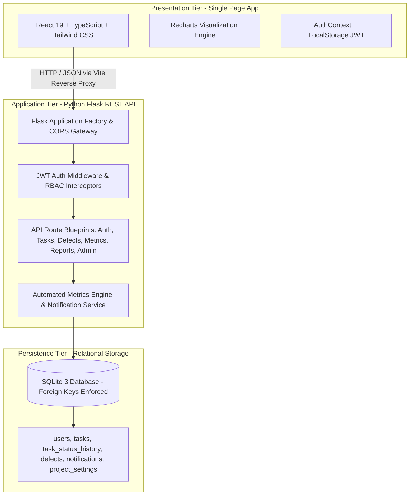
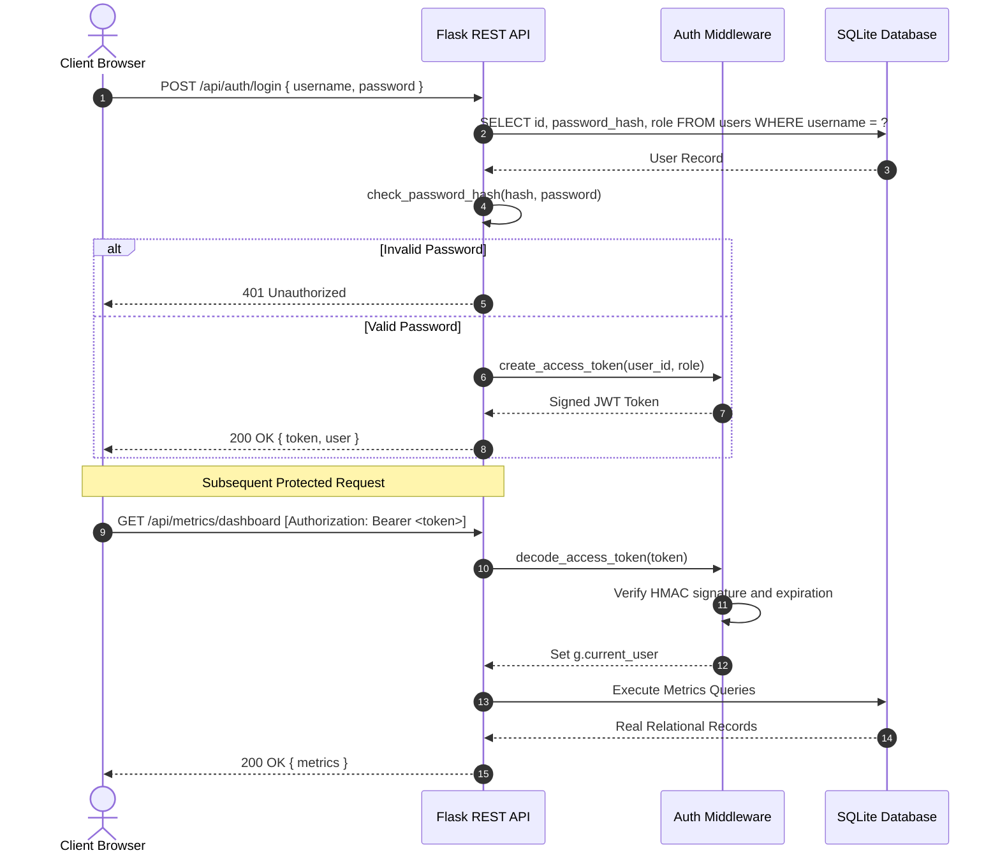

# System Architecture Document

## 1. Architectural Overview
The **Micro-Task Management System** utilizes an industry-standard **Three-Tier Layered Architecture** emphasizing loose coupling, separation of concerns, and clean data contracts between the presentation layer, the business logic layer, and the persistence layer.

---

## 2. Layer Decomposition

### 2.1 Presentation Tier (Frontend)
- **Framework:** React 19 with TypeScript, bundled with Vite 8.
- **Styling:** Tailwind CSS v4 design system with tailored colors, responsive cards, badging, and accessible focus states.
- **Data Visualization:** Recharts library rendering Bar Charts, Donut Charts, and Histograms with responsive SVG viewports.
- **State Management:** React Context API (`AuthContext`) managing user session tokens and reactive authorization roles.
- **API Communication:** Centralized `ApiClient` with asynchronous fetch abstractions, authorization header injection, and automatic session expiration handling.

### 2.2 Application Tier (Backend REST API)
- **Framework:** Python Flask 3.x WSGI service.
- **Authentication & Security:** 
  - Password hashing utilizing `werkzeug.security` (Scrypt algorithm).
  - Stateless JSON Web Tokens (`PyJWT`) containing user ID, username, and role, signed via HMAC-SHA256.
  - Route decorators (`@jwt_required`, `@roles_required`) enforcing declarative server-side role validation.
- **Metrics Calculation Engine:** `MetricsEngine` module reading directly from SQLite row factories, applying ISO timestamp arithmetic with `python-dateutil`, and enforcing boundary case protections (e.g. division-by-zero mitigation).
- **Notification Daemon:** Lazy evaluation pipeline that detects upcoming deadlines and overdue milestones upon task retrieval, inserting unread notification rows with daily deduplication keys.

### 2.3 Persistence Tier (Database)
- **Engine:** SQLite 3 with `PRAGMA foreign_keys = ON;` connection configuration.
- **Transaction Safety:** Python `contextmanager` handling atomic commits and transaction rollback upon unexpected runtime exceptions.
- **Indexing Strategy:** B-Tree indexing on frequently filtered columns (`assigned_to_id`, `status`, `due_date`, `completed_at`, `created_at`).

---

## 3. Security Architecture

