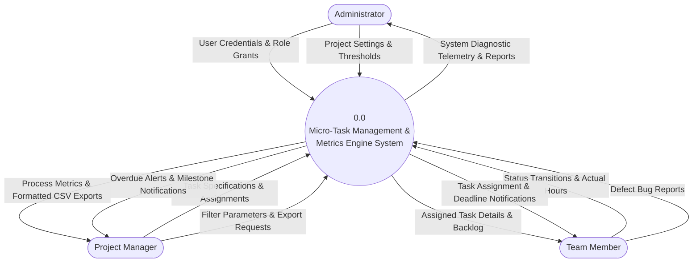
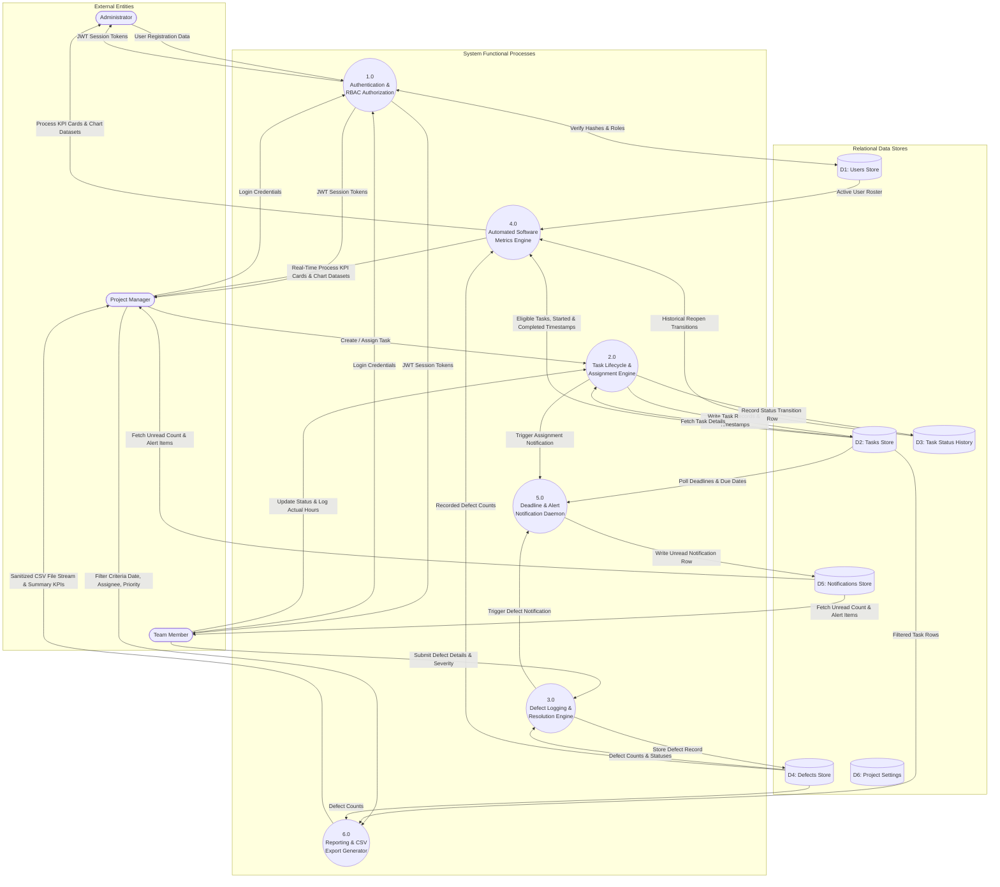

# Data Flow Diagrams (DFD)

This document contains editable, standard-compliant Data Flow Diagrams for the **Micro-Task Management System**, explicitly distinguishing External Entities, Processes, Data Stores, and Data Flows.

---

## 1. DFD Level 0: Context Analysis Diagram

The Level 0 Context Diagram represents the entire system as a singular process bubble interacting with the three primary human external entities.

---

## 2. DFD Level 1: Sub-System Process Decomposition

The Level 1 diagram decomposes the system into functional sub-processes, showing interactions with persisted relational data stores.

