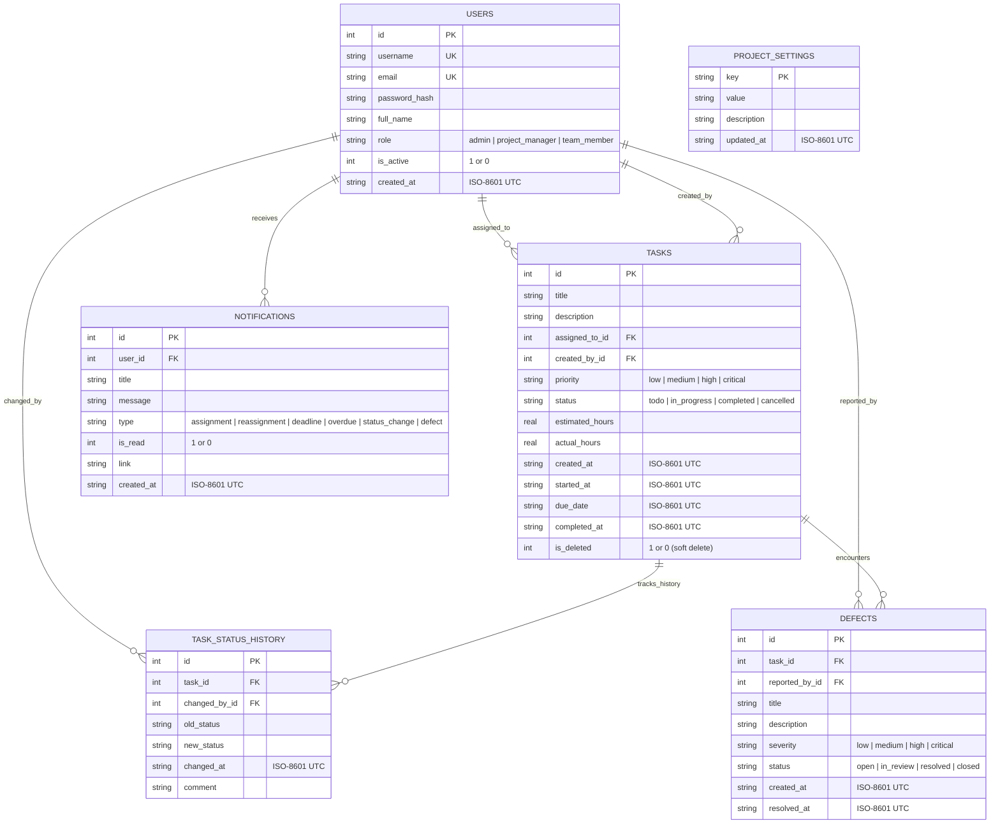

# Database Design & Entity-Relationship (ER) Specification

## 1. Relational Entity-Relationship Diagram (ERD)

The following Mermaid ER Diagram models the relational entities, primary keys (PK), foreign keys (FK), constraints, and cardinalities implemented in the SQLite database.



---

## 2. Table Data Dictionaries

### 2.1 Table: `users`
Persists registered system accounts, hashed credentials, and system roles.

| Column | Type | Constraints | Description |
|---|---|---|---|
| `id` | INTEGER | PRIMARY KEY AUTOINCREMENT | Unique user identifier |
| `username` | TEXT | UNIQUE, NOT NULL | Account handle for login |
| `email` | TEXT | UNIQUE, NOT NULL | Electronic mail address |
| `password_hash` | TEXT | NOT NULL | Scrypt cryptographic hash |
| `full_name` | TEXT | NOT NULL | Human-readable user name |
| `role` | TEXT | CHECK(role IN ('admin', 'project_manager', 'team_member')) | Access control role |
| `is_active` | INTEGER | NOT NULL DEFAULT 1 | 1 for active, 0 for deactivated |
| `created_at` | TEXT | NOT NULL | ISO-8601 registration timestamp |

---

### 2.2 Table: `tasks`
Core entity tracking software work items, assignees, effort metrics, and lifecycle timestamps.

| Column | Type | Constraints | Description |
|---|---|---|---|
| `id` | INTEGER | PRIMARY KEY AUTOINCREMENT | Unique micro-task identifier |
| `title` | TEXT | NOT NULL | Short summary of task deliverable |
| `description` | TEXT | NULL | Detailed specifications / acceptance criteria |
| `assigned_to_id` | INTEGER | REFERENCES users(id) ON DELETE SET NULL | Assigned engineer user ID |
| `created_by_id` | INTEGER | REFERENCES users(id) ON DELETE SET NULL | Authoring manager user ID |
| `priority` | TEXT | CHECK(priority IN ('low', 'medium', 'high', 'critical')) | Task urgency level |
| `status` | TEXT | CHECK(status IN ('todo', 'in_progress', 'completed', 'cancelled')) | Current lifecycle state |
| `estimated_hours` | REAL | DEFAULT 0.0 | Estimated engineering effort |
| `actual_hours` | REAL | DEFAULT 0.0 | Cumulative logged hours |
| `created_at` | TEXT | NOT NULL | Task creation timestamp |
| `started_at` | TEXT | NULL | Timestamp when first entering `in_progress` |
| `due_date` | TEXT | NULL | Target deadline timestamp |
| `completed_at` | TEXT | NULL | Timestamp when marked `completed` |
| `is_deleted` | INTEGER | NOT NULL DEFAULT 0 | 1 indicates soft-deleted record |

---

### 2.3 Table: `task_status_history`
Append-only audit ledger recording historical transitions to compute rework metrics.

| Column | Type | Constraints | Description |
|---|---|---|---|
| `id` | INTEGER | PRIMARY KEY AUTOINCREMENT | Ledger record identifier |
| `task_id` | INTEGER | NOT NULL REFERENCES tasks(id) ON DELETE CASCADE | Associated parent task ID |
| `changed_by_id` | INTEGER | REFERENCES users(id) ON DELETE SET NULL | User who triggered transition |
| `old_status` | TEXT | NULL | Previous task state |
| `new_status` | TEXT | NOT NULL | New task state |
| `changed_at` | TEXT | NOT NULL | Transition timestamp |
| `comment` | TEXT | NULL | Note or justification for transition |

---

### 2.4 Table: `defects`
Captures bugs and quality issues linked directly to parent engineering tasks.

| Column | Type | Constraints | Description |
|---|---|---|---|
| `id` | INTEGER | PRIMARY KEY AUTOINCREMENT | Defect record identifier |
| `task_id` | INTEGER | NOT NULL REFERENCES tasks(id) ON DELETE CASCADE | Parent task ID |
| `reported_by_id` | INTEGER | REFERENCES users(id) ON DELETE SET NULL | Reporting user ID |
| `title` | TEXT | NOT NULL | Defect title / summary |
| `description` | TEXT | NULL | Steps to reproduce and symptoms |
| `severity` | TEXT | CHECK(severity IN ('low', 'medium', 'high', 'critical')) | Impact level |
| `status` | TEXT | CHECK(status IN ('open', 'in_review', 'resolved', 'closed')) | Defect lifecycle state |
| `created_at` | TEXT | NOT NULL | Defect discovery timestamp |
| `resolved_at` | TEXT | NULL | Verification and fix timestamp |

---

### 2.5 Table: `notifications`
In-app messaging log for milestone alerts and assignments.

| Column | Type | Constraints | Description |
|---|---|---|---|
| `id` | INTEGER | PRIMARY KEY AUTOINCREMENT | Notification record ID |
| `user_id` | INTEGER | NOT NULL REFERENCES users(id) ON DELETE CASCADE | Target recipient user ID |
| `title` | TEXT | NOT NULL | Notification headline |
| `message` | TEXT | NOT NULL | Detailed notification body |
| `type` | TEXT | CHECK(type IN ('assignment', 'reassignment', 'deadline', 'overdue', 'status_change', 'defect')) | Event category |
| `is_read` | INTEGER | NOT NULL DEFAULT 0 | 0 for unread, 1 for acknowledged |
| `link` | TEXT | NULL | Internal routing link (e.g. `/tasks/5`) |
| `created_at` | TEXT | NOT NULL | Notification issuance timestamp |

---

### 2.6 Table: `project_settings`
Configurable key-value system settings and agile sprint target thresholds.

| Column | Type | Constraints | Description |
|---|---|---|---|
| `key` | TEXT | PRIMARY KEY | Configuration parameter identifier |
| `value` | TEXT | NOT NULL | Parameter string value |
| `description` | TEXT | NULL | Human explanation of the setting |
| `updated_at` | TEXT | NOT NULL | Last modification timestamp |

---

## 3. Database Indexing & Optimization

The following B-Tree indexes are created during initialization to guarantee rapid filtering and query execution:

```sql
CREATE INDEX idx_tasks_assigned_to ON tasks(assigned_to_id);
CREATE INDEX idx_tasks_status ON tasks(status);
CREATE INDEX idx_tasks_due_date ON tasks(due_date);
CREATE INDEX idx_tasks_completed_at ON tasks(completed_at);
CREATE INDEX idx_tasks_created_at ON tasks(created_at);
CREATE INDEX idx_status_history_task ON task_status_history(task_id);
CREATE INDEX idx_defects_task ON defects(task_id);
CREATE INDEX idx_notifications_user_read ON notifications(user_id, is_read);
```
